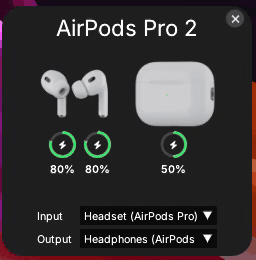

# WinPod

<p align="center">
  
</p>

Just a small project: an AirPods battery popup for Windows, like the one on iPhone.

## Built with

| Library | Used for |
|---|---|
| C++/WinRT | Bluetooth LE advertisements, Bluetooth Classic device lookup |
| Win32, Direct3D 11, DWM | Window, tray icon, rendering, transparent rounded toast |
| Core Audio (MMDevice) | Audio device list, device change events, default device |
| [Dear ImGui](https://github.com/ocornut/imgui) | UI |
| [trantor](https://github.com/an-tao/trantor) | Event loops for the UI and the Bluetooth thread |
| [spdlog](https://github.com/gabime/spdlog) | Logging |
| [nlohmann/json](https://github.com/nlohmann/json) | Sprite sheet layout files |
| [stb_image](https://github.com/nothings/stb) | PNG loading |
| [GoogleTest](https://github.com/google/googletest) | Unit tests |
| [vcpkg](https://github.com/microsoft/vcpkg) | Package manager |
| [Inter](https://github.com/rsms/inter), [Font Awesome Free](https://fontawesome.com) | Fonts and icons (licenses in `resources/fonts/`) |

## Building

You need Windows 11, Visual Studio 2026 with the C++ desktop workload, and CMake 3.25+.

```
git clone --recurse-submodules https://github.com/longsamaa/winpod.git
cd winpod
external\vcpkg\bootstrap-vcpkg.bat -disableMetrics
cmake -B build
cmake --build build --config Release
```

The exe ends up in `build/bin/Release/`, with `resources/` copied next to it. Logs go to `logs/app.log` beside the exe.

Tests: `ctest --test-dir build -C Debug` after a Debug build.

## References

- https://inria.hal.science/hal-02394619/document

